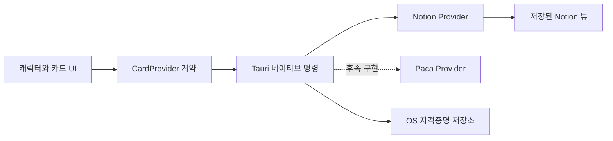

# Card Captor 구조

## 결정

Tauri 2의 네이티브 계층에 창·자격증명·외부 API 접근을 두고, React UI는 캐릭터와 정규화된 카드만 다룬다. 첫 Provider는 Notion이며 이후 Paca 구현을 추가한다.

Codex 관측은 업무 카드 Provider와 분리된 네이티브 서비스다. `src-tauri/src/codex/protocol.rs`가 로컬 소켓의 발견·소유자 조회·구독·재연결을, `core.rs`가 snapshot/patch 병합·상태 투영·중복 억제를 담당한다. `mod.rs`가 자체 `codex.json` 설정과 OS 알림·번들 사운드 재생을 소유한다. Notion 자격증명과 연결하지 않는다.

UI는 `get_codex_feed`와 `codex-feed` 이벤트로 정규화된 작업·활동만 받고 revision으로 늦은 초기 조회를 폐기한다. Mini 말풍선은 OS 알림 이벤트와 독립적으로 같은 작업 상태를 받아 제목 1줄·최신 진행 내용 1줄로 갱신한다. 진행·입력 대기는 유지하고 완료·실패·중단은 6.5초 후 숨긴다. 타임스탬프만 바뀐 push는 표시 시간을 늘리지 않는다.

`set_codex_preferences`, `test_codex_alert`, `open_codex_thread`를 제공하며 마지막 명령은 작업 또는 최근 활동에 있는 UUID만 허용한다. 팝업 피드의 항목 전체가 대화 열기 버튼이다. 메시지·승인을 보내는 네이티브 명령은 없다. 피드 탭은 Codex와 Notion을 전환하고, 같은 캐릭터 선택과 창 제어를 공유한다.

구독은 같은 UID의 검증된 Unix 소켓으로 제한한다. 프레임·대화당 상태 8 MiB, 작업 12개, 활동 40개, 중복 키 512개를 상한으로 둔다. 단편화된 읽기는 타이머와 경쟁해 취소하지 않는다. revision 누락 시 오래된 상태로 표시하고 재구독한 snapshot을 조용히 기준으로 삼는다. 전체 대화·도구 인자는 파일이나 로그로 보관하지 않으며, 상세 프로토콜·경계는 [Codex 관측](codex-observer.md)을 따른다.

| 계층 | 책임 | 소유하지 않는 것 |
| --- | --- | --- |
| 캐릭터 UI | 이동 상태·드래그·카드 탐색·상태 선택·영역별 포인터 판정 | 토큰 영속화·외부 API 호출 |
| 카드 Provider 계약 | 카드 목록·갱신 시각·추가 결과·연결 상태 | 공통 필터 언어 |
| 네이티브 앱 | 창·포커스·트레이·원본 열기·설정·자격증명 | 업무 필터의 공통 의미 |
| Notion Provider | 뷰 실행·페이지 보강·상태 스키마 조회·상태 변경·응답 정규화·오류 처리 | 캐릭터 동작 |
| Paca Provider 예정 | Paca 인증·저장된 검색 실행·응답 정규화 | Notion 뷰 해석 |

## 창과 입력

주 모니터의 작업 영역을 투명한 상시 위 창으로 덮고, 그 안에서 캐릭터를 이동시킨다. 캐릭터·카드 패널 위에서는 입력을 받고 빈 영역에서는 클릭을 통과시킨다. 카드 패널을 열면 자율 이동을 멈추고 텍스트 입력을 위한 포커스를 허용한다.

물리 좌표인 데스크톱 커서 위치를 창 위치와 배율로 변환하여 UI 영역과 비교한다. 첫 버전은 주 모니터 안에서만 이동하며, 다중 모니터 사이의 이동은 별도 기능으로 둔다.

전체 화면 위젯의 클릭 통과·포커스·작업 공간 노출은 OS별 수동 검증 대상이다. 웹 미리보기는 네이티브 입력 동작의 검증을 대신하지 않는다.

## 렌더링과 GPU

캐릭터는 PixiJS의 WebGL 렌더러로 그린다. 카드 UI는 React로 유지하며 캐릭터 렌더러의 생성·상태 변경·수동 그리기·해제를 별도 경계에 둔다. 캡터의 코드 기반 SVG와 웰루니의 번들 PNG를 같은 렌더러에서 선택하고, 변경 시 이전 렌더러를 해제한다. 이후 Live2D나 3D를 도입할 때 이 경계에 맞는 렌더러와 리소스를 추가한다. Live2D·3D 모델은 포함하지 않는다.

WebGL 캔버스는 캐릭터 크기인 168×160 CSS 픽셀로 제한하고, 배율은 최대 2배로 제한한다. `powerPreference: 'low-power'`를 요청하며 자동 Ticker를 사용하지 않는다. 이 설정은 GPU 선택에 대한 힌트이며 실제 하드웨어 사용이나 소비 전력을 보장하지 않는다. [PixiJS WebGL 옵션](https://pixijs.download/v8.23.0/docs/rendering.ContextSystemOptions.html)

WebGL 초기화 실패나 컨텍스트 손실 시 정적인 SVG로 전환하고 렌더링 경로를 구분한다. 이동 위치는 CSS `translate3d`로 반영한다.

| 상태 | 캐릭터와 이동 갱신 정책 |
| --- | --- |
| 걷기·캐릭터 애니메이션 | 최대 30 FPS |
| 드래그 위치 | 포인터 입력 이벤트에 따라 즉시 반영 |
| 대기 | 연속 프레임 루프를 멈추고 다음 동작을 예약 |
| 카드 열람·이동 중지 | 상태가 바뀔 때만 다시 그림 |
| 숨김·동작 줄이기 | 애니메이션 예약 중지 |

커서 감시는 캐릭터·패널 근처에서 50ms, 멀리서는 250ms 간격으로 조절하고 숨김 상태에서는 중지한다. 캐릭터를 직접 그리는 캔버스 면적과 입력을 통과시키는 네이티브 창 면적은 구분한다. 네이티브 창은 첫 버전의 주 모니터 작업 영역을 유지한다.

| 프로젝트 | 캐릭터 렌더링 경로 | 대체 경로 |
| --- | --- | --- |
| BongoCat | macOS [Metal](https://github.com/ayangweb/BongoCat/blob/master/crates/bongocat-overlay/src/macos/renderer.rs#L129), Windows [D3D11·DirectComposition](https://github.com/ayangweb/BongoCat/blob/master/crates/bongocat-overlay/src/windows/renderer.rs#L813) | Windows 하드웨어 장치 생성 실패 시 WARP 사용 |
| WindowPet | 데스크톱 캐릭터에 [Phaser.AUTO](https://github.com/SeakMengs/WindowPet/blob/main/src/PhaserWrapper.tsx#L27) 사용 | [WebGL 사용 가능 시 선택하고, 그렇지 않으면 Canvas 사용](https://github.com/phaserjs/phaser/blob/v3.80.1/src/core/CreateRenderer.js#L34) |

저전력 여부는 GPU 가속 유무만으로 판단하지 않고, 유휴 FPS·오버레이 면적·커서 폴링 주기를 함께 측정해 결정한다. macOS M1 Max에서 릴리스 앱의 상태별 CPU·GPU 시간과 시스템 전력을 [실측했다](measurements/2026-11-17-macos/REPORT.md). 시스템 배경 전력 변동이 커 앱의 추가 총소비전력 W는 확정하지 않았다. Windows 실측은 후속 범위다.

## Provider 계약

`src/contracts.ts`가 UI 계약을 정의한다. `CardSummary`는 원본 ID·제목·URL·상태·상태 색상 토큰·날짜를, `FeedSnapshot`은 카드·마지막 성공 시각·추가 결과·경고를 담는다. 상태 이름과 색상은 같은 속성에서 읽으며, null Status의 기본 상태 색상도 기존 스키마 조회에서 함께 해석한다. Notion 고유 속성은 변환 단계에서 처리한다.

`CardProvider`의 연결·조회·원본 열기에 더해 `getCardStatus`, `updateCardStatus`로 상태를 편집한다. 공통 계약은 필드·선택지 ID와 표시 이름만 전달하며 Notion 속성 타입·PATCH 본문은 Provider가 소유한다. 실제 호출은 다음 네이티브 명령으로 연결한다.

| 명령 | 책임 |
| --- | --- |
| `get_setup` | 설정·토큰 존재 여부·마지막 목록 조회 |
| `save_setup` | 설정 검증·토큰 보관. 토큰 원문은 응답하지 않음 |
| `refresh_feed` | 현재 연결을 조회해 새 목록 반환 |
| `disconnect` | 자격증명과 연결 데이터 제거 |
| `open_card` | 마지막 목록의 카드 ID로 원본 URL 확인 후 열기 |
| `get_card_status` | 현재 목록 카드의 페이지·데이터 소스에서 실제 상태 속성·선택지 조회 |
| `update_card_status` | 현재 목록·현재 스키마의 필드·선택지 ID 검증 후 상태 속성 하나만 저장 |
| `set_panel_open` | 카드·설정 패널의 포커스 정책 적용 |

현재 설정의 `viewId`는 Notion 전용이다. Paca를 추가할 때 Provider 선택과 서비스별 설정을 확장한다. UI의 카드 표시 계약은 유지하고, 필터 변환기를 미리 만들지 않는다.

## Notion 조회

1. 뷰 링크·ID를 검증하고 `viewId`로 정규화한다.
2. `Notion-Version: 2026-03-11`을 명시하여 저장된 뷰 쿼리를 만든다.
3. 뷰가 적용한 순서를 유지하며 페이지 참조를 읽고 최대 20개 카드의 속성을 보강한다.
4. 성공한 결과만 마지막 목록으로 교체한다. 추가 결과와 불완전한 조회를 구분하여 안내한다.
5. 조회용 임시 쿼리는 정리한다. 제한 응답은 `Retry-After`와 제한된 재시도로 처리한다.

표시할 Status 값이 null이면 데이터 소스 스키마의 `default_option` 이름으로 실제 표시 상태를 해석한다. 필요한 데이터 소스만 조회당 한 번 조회하고 최대 2개를 병렬 처리한다. 이 메타데이터 조회에 실패해도 카드 목록을 유지하고 기본 상태 확인 실패 경고를 추가한다.

호출 대상은 네이티브 코드의 고정된 Notion API 주소다. 브라우저에서 토큰을 넣어 직접 API를 호출하지 않는다. 뷰 필터·정렬은 Notion이 실행하며 앱이 재해석하지 않는다. [공식 뷰 가이드](https://developers.notion.com/guides/data-apis/working-with-views), [뷰 쿼리 생성](https://developers.notion.com/reference/create-view-query)

## 자격증명과 실패 경계

상태 편집기는 카드 제목의 원본 열기와 별도의 버튼이다. native Status 속성을 우선하며, 없을 때만 이름이 Status·상태·진행 상태인 Select를 지원한다. 여러 상태 속성은 사용자가 선택한다. 쓰기는 기존 옵션 ID를 사용하므로 상태 선택지나 뷰 설정을 만들거나 바꾸지 않는다. [페이지 변경 API](https://developers.notion.com/reference/patch-page), [속성 스키마](https://developers.notion.com/reference/property-object)

상태 옵션은 `StatusOptionsCache`에서 카드별로 메모리에 보관한다. 캐시가 있으면 편집기를 즉시 펼치고 매번 뒤에서 갱신하며, 최초 조회만 로딩 화면을 사용한다. 캐시는 카드 패널의 수명과 분리하고 현재 카드 목록 범위로 제한한다. 토큰·뷰 변경 및 연결 해제 시 비우며, 확정된 쓰기 이후 도착한 예전 조회는 캐시를 덮거나 복구할 수 없다.

연결 변경·새로고침·상태 조회·상태 저장은 네이티브 비동기 잠금으로 직렬화한다. UI도 쓰기 전 진행 중인 조회를 무효화하고 완료를 기다린다. API가 반환한 저장 성공을 확인한 뒤 카드 캐시를 갱신하고 저장된 뷰를 다시 조회하여 필터·정렬을 반영한다. 저장은 성공했지만 로컬 저장이나 후속 조회가 실패한 경우 쓰기를 실패로 되돌리지 않고 별도 안내한다. 쓰기 응답이 불명확한 통신 실패는 자동 재전송하지 않으며 새로고침으로 실제 상태를 확인하도록 안내한다.

토큰은 네이티브 계층을 통해 OS 자격증명 저장소에만 영속화한다. 설정 파일은 뷰·갱신 주기·이동 설정과 카드 캐시를 보관한다. 토큰 저장 실패 시 연결 저장도 실패로 알리고 평문 대체를 하지 않는다.

기존 카드가 있는 상태에서 갱신이 실패하면 해당 목록을 유지하고 오래된 데이터임을 표시한다. 최초 빈 결과, 권한 거부, 인증 실패, 네트워크 실패를 같은 상태로 처리하지 않는다.

## 참고한 프로젝트

| 프로젝트 | 확인한 구조 | 적용 판단 |
| --- | --- | --- |
| [Mochi](https://github.com/likhith1542/mochi) | Tauri 2, 이동 FSM·드래그 물리·말풍선 영역별 클릭 통과 | 이동·상호작용 패턴 참고. 소스와 캐릭터 리소스의 전체 복제는 하지 않음 |
| [BongoCat](https://github.com/ayangweb/BongoCat) | 현행 Rust·GPUI 구조의 overlay/platform 분리 | OS별 창·디스플레이·트레이의 책임 경계 참고 |

Mochi 저장소의 라이선스는 MIT, BongoCat은 Apache-2.0이다. BongoCat의 Live2D SDK·모델은 별도 조건이 있으므로 코드 라이선스와 동일하게 취급하지 않는다. 캡터는 앱 내부의 자체 코드 기반 그림이며, 웰루니는 사용자가 지정한 캐릭터보드에서 파생한 번들 이미지다. [Mochi 라이선스](https://github.com/likhith1542/mochi/blob/main/LICENSE), [BongoCat 라이선스](https://github.com/ayangweb/BongoCat/blob/master/LICENSE), [Cubism 경계 문서](https://github.com/ayangweb/BongoCat/blob/master/docs/cubism/cubism-sdk-source-and-license.md)
