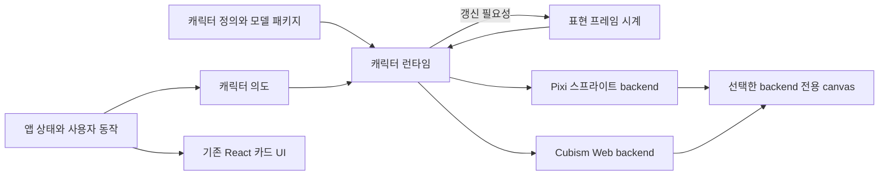

# 표현 계층 전환 검토

검토일: 2026-11-18. 대상: Card Captor `7fe3c64` 이후 작업본. 우선 목표: **캐릭터 표현 확장과 라이선스 비용 억제**. 상태: Live2D 연동 중단, Rive 공식 샘플의 macOS 네 상태 검증 완료.

사용자의 비용 우선순위에 따라 Cubism 샘플 연동을 중단했다. 준비 중이던 앱 변경은 로컬 보관하고 기존 앱 소스로 복귀했다. 실제 Live2D 모델의 앱 실행·네 상태 검증은 완료하지 않았다. Tauri·React와 Notion Provider는 유지한다.

후속 선택은 **Rive의 공식 MIT 샘플 한 개**다. 먼저 로컬 WASM·모델, host 시계와 실제 계정에서 분리한 합성 카드로 검증했다. 일반 모드에도 기본 로봇·Rive의 저장 가능한 캐릭터 선택을 연결하며 기존 Notion Provider를 사용한다. 현재 구현·상태 매핑·모드별 실행·검증 결과는 [Rive 동작 검증](rive-validation.md)을 따른다.

## 비용을 반영한 대안 비교

가격은 2026-11-18 공식 페이지의 USD 표시 기준이며, 일러스트·모델·리깅 제작비와 자산 사용권은 별도다. 아래 통합 난이도는 공식 기능·소스에 근거한 판단이며 Card Captor 실제 실행 검증 결과는 아니다.

| 후보 | 런타임·제작 도구 비용 | 가능한 표현 | 현재 앱에서의 판단 |
| --- | --- | --- | --- |
| PixiJS 확장 | MIT, 런타임 비용 없음. 자산 제작 도구는 별도 선택 | 프레임 애니메이션·레이어·메시 변형·파티클·shader | 기존 Pixi 8 재사용. 비용 0을 우선할 때 첫 후보. 리깅·파라미터 편집 도구는 직접 준비해야 함 |
| Rive | 런타임 MIT·로열티 없음. Free 내보내기는 시작 화면 포함. Cadet 월 결제 $17/인 또는 연 $108 선불 | 본·메시·IK·표정·시선·상태 머신 | 공식 React/WebGL2 런타임 제공. 적은 통합 비용으로 리깅을 도입할 때 첫 후보 |
| Inochi2D | SDK·Creator 소스 BSD-2-Clause. Creator 공식 바이너리 $40 이상 일회 구매, 평가판·소스 빌드 가능 | 레이어 그림의 파라미터 기반 2D 변형·리깅 | Live2D와 가까운 표현. 공식 WASM 경로는 있으나 Pixi adapter가 미완성이라 개발 검증 부담 큼 |
| Spine + PixiJS | 유효한 Editor 라이선스 필요. 현재 Essential $69, Pro $379 일회 구매. 메시 제작은 Pro 필요 | 본·메시·IK·모션 혼합 | 공식 Pixi 8 런타임 제공. 구독 대신 일회 구매가 가능할 때 후보. 매출·투자 등 합산 $500,000 기준의 Enterprise 조건 별도 |
| Three.js + glTF/VRM | Three.js·three-vrm MIT, 런타임 비용 없음. 모델 사용권 별도 | 실제 3D 자세·표정·시선·툰 표현 | 3D 캐릭터로 범위를 넓힐 때 후보. 모델·카메라·재질 관리 추가 |

- **기본 제안:** 리깅 도구와 앱 통합의 균형은 Rive를 우선 검증한다. 무료 시작 화면 허용 여부와 유료 제작 도구 비용을 함께 판단한다. 완전한 오픈 소스 제작·실행 경로가 우선이면 Pixi 확장을 선택하고, Inochi2D는 별도 adapter 실험으로 다룬다.
- **표현의 차이:** Pixi의 Mesh 기능은 Live2D 리깅 시스템을 제공하지 않는다. Rive의 본·메시·IK도 Cubism의 물리·모델 호환성을 보장하지 않는다. 기존 Live2D 모델은 다른 런타임에서 그대로 재생할 수 있다고 가정하지 않는다.
- **공통 검증:** 대기·이동·드래그·카드 열람에 모델별 행동을 연결하고, 공간 이동과 제자리 애니메이션을 분리한다. Tauri 릴리스에서 로컬 자산·WASM/CSP·투명도·자원 해제·컨텍스트 복구를 확인한다.

근거:

- Pixi: [MIT](https://github.com/pixijs/pixijs/blob/main/LICENSE), [Mesh](https://pixijs.com/8.x/guides/components/scene-objects/mesh), [ParticleContainer](https://pixijs.com/8.x/guides/components/scene-objects/particle-container).
- Rive: [현재 가격](https://rive.app/docs/account-admin/pricing), [런타임 MIT·로열티 없음](https://github.com/rive-app/rive-react), [React WebGL2](https://rive.app/docs/runtimes/react/react), [메시 변형](https://rive.app/docs/editor/manipulating-shapes/meshes). 예전의 “내보내기 자체가 유료” 안내 대신 현재 Free의 시작 화면 조건을 적용한다.
- Inochi: [SDK 라이선스](https://github.com/Inochi2D/inochi2d/blob/main/LICENSE), [Creator 공식 판매·평가·소스 빌드](https://kitsunebi-games.itch.io/inochi-creator), [공식 WASM 경로](https://github.com/Inochi2D/inochi2d#webassembly). 검토한 commit `0f6330f7c3c3de0645ecc7c54ba86a2fd65f134f`에는 [빈 Pixi adapter](https://github.com/Inochi2D/inochi2d/blob/0f6330f7c3c3de0645ecc7c54ba86a2fd65f134f/web/inochi2d-pixijs/src/inpixi.ts)와 [미구현 draw-list wrapper](https://github.com/Inochi2D/inochi2d/blob/0f6330f7c3c3de0645ecc7c54ba86a2fd65f134f/web/inochi2d-ts/src/core.ts#L452-L458)가 있다. Rust 포트 [Inox2D](https://github.com/Inochi2D/inox2d)도 prototype이며 production 사용을 권하지 않는다고 명시한다.
- Spine: [구매 가격·기능](https://us.esotericsoftware.com/spine-purchase), [Editor·runtime 조건](https://us.esotericsoftware.com/spine-editor-license), [공식 Pixi 런타임](https://us.esotericsoftware.com/spine-pixi). Essential/Pro의 적용 여부는 제품 매출만으로 판단하지 않는다.
- Three: [Three.js MIT](https://github.com/mrdoob/three.js/blob/dev/LICENSE), [three-vrm](https://github.com/pixiv/three-vrm), [모델별 VRM 권리 설정](https://vrm.dev/en/licenses/1.0/).

Live2D는 개발·검증 자체가 무료이고 개인·소규모의 일반 배포 면제가 있지만, 임의 모델 추가 등 Expandable Application은 별도 조건이다. 모든 개인용 위젯에 같은 고액 라이선스가 필요하다고 단정하지 않는다. 이번 보류는 향후 배포·모델 확장 조건까지 포함한 사용자의 선택이다. [SDK 배포 조건](https://www.live2d.com/en/sdk/license/), [Expandable Application](https://www.live2d.com/en/sdk/license/expandable/)

## 이전 Cubism 기술 검토 — 채택 보류

이하의 Cubism 전용 계약·검증 순서는 비용 검토 이전의 후보 자료이며 현재 구현 계획을 뜻하지 않는다. 첫 후보였던 **Tauri·React 카드 UI 유지 + Cubism SDK for Web**의 공식 안정판 sample은 WebGL2를 사용한다. Live2D 도입 자체가 네이티브 창이나 GPUI 전체 전환을 요구하지는 않지만, 실제 Tauri WebView·릴리스 CSP와의 결합은 실행 검증되지 않았다. [공식 WebGL2 초기화](https://github.com/Live2D/CubismWebSamples/blob/ed1e0b714826d92469b9e51cacc3346f4e393f03/Samples/TypeScript/Demo/src/lappglmanager.ts#L13-L24)

핵심 변경은 GPU 라이브러리보다 **모델 패키지·행동 매핑·표현 시계**다. 현재 `state/elapsedMs/blink` 계약과 유휴 정지 정책으로는 호흡·시선·표정 혼합·물리를 충분히 다룰 수 없다. BongoCat에서는 모델과 행동을 분리하는 구조를 우선 참고하고, native overlay는 요구 표현이 Web 경로에서 성립하지 않을 때 재평가한다.

## 확장 경로 선택

| 경로 | 얻는 표현 | 기존 기능 재사용 | 판단 |
| --- | --- | --- | --- |
| Pixi 스프라이트 시트 | 제작한 프레임·방향별 애니메이션 | 현재 창·카드·Provider 유지 | 프레임 기반 자산을 사용할 때의 별도 backend |
| Cubism Web 런타임 | 모델 변형·모션·표정·시선·물리 | 현재 창·카드·드래그·Provider 유지 가능 | 비용 조건으로 보류 |
| native Cubism + React 카드 | native SDK의 캐릭터 표현 | 카드 UI·Rust Provider 유지 | WebView·SDK 기능·측정된 비용 제약이 있을 때 후보 |
| Rust·GPUI 전체 UI | native 캐릭터와 카드·설정 UI | Rust 데이터·권한 모델과 동작 명세 유지 | 캐릭터 표현 확장만으로 선택할 이유는 부족 |

스프라이트 시트는 Live2D 리깅을 대체하지 않으며, Live2D 모델을 준비했다고 카드 UI를 다시 구현할 필요도 없다. 첫 검증에서는 현재 168×160 표시 크기와 창 구성을 고정해 모델 표현의 성립 여부에 집중한다.

## 현재 구현에서 바꿔야 할 경계

| 항목 | 현재 구현 | 필요한 변경 |
| --- | --- | --- |
| 프레임 예약 | 걷기만 연속 갱신. idle은 눈깜빡임 두 프레임, browsing은 상태 변경 시 한 프레임 | 모션·호흡·물리·fade 등 runtime의 갱신 요구를 scheduler에 전달 |
| 시간 | 상태 전환 때 `elapsedMs`가 0부터 재시작 | 모델의 연속 시간·delta와 앱 상호작용 상태 전이를 분리 |
| 표현 입력 | `state`, `elapsedMs`, `blink` | 의미 있는 앱 의도와 모델별 motion·expression·parameter 매핑 |
| GPU 소유권 | Pixi가 WebGL2 context·clear·draw·리소스 복구 소유 | 선택한 backend 하나가 canvas와 context를 소유 |
| 수명 관리 | 초기화 취소·세대 확인·destroy | 기존 패턴 재사용. 모델 교체와 lazy motion 요청까지 소유권 확대 |
| 크기·기준점 | TS·SVG·CSS에 고정된 168×160과 개별 좌표 | viewport·접지점·fit·입력 영역을 캐릭터 정의에서 관리 |
| 실패 대체 | 자체 로봇의 정적 SVG | 모델별 정지 이미지 또는 기본 로봇으로 복귀 |

근거: [렌더러 계약](../src/renderer/contract.ts#L5), [예약 정책](../src/renderer/animation.ts#L42), [상태별 시계](../src/renderer/animation.ts#L23), [Pixi context](../src/renderer/pixi.ts#L29), [비동기 수명](../src/renderer/lifetime.ts#L4), [현재 자산 사양](character-sprites.md)

Notion 조회·상태 쓰기·옵션 캐시·트레이·React 카드 UI는 이 변경과 분리해 유지한다. 기존 DOM 이동·드래그·클릭 통과도 첫 검증에서 유지하며, 카드 개수 배지와 캡션은 기존 DOM 레이어를 사용할 수 있다.

## 제안하는 캐릭터 구조

위 도식은 제안이다. 두 backend가 같은 context에 동시에 그리는 구성은 첫 단계에서 사용하지 않는다.

| 계약 | 담을 책임 |
| --- | --- |
| `CharacterDefinition` | ID·버전·format·진입 파일, 표시 크기·접지점·입력 영역, 기본 자세·대체 이미지, 의미 상태별 동작 매핑 |
| `CharacterIntent` | 상호작용 상태·이동 방향·정규화한 시선 목표, 카드 수와 변경 사건. 특정 모델의 파일명은 포함하지 않음 |
| `CharacterRuntime` | 모델 로딩, 의도 전이, delta 기반 갱신, 그리기, 지원 기능과 갱신 요구, resize·pause·destroy |
| `FrameScheduler` | 활성 모션·물리·시선 응답에 필요한 프레임 예약, 숨김·동작 줄이기·정지·복귀 정책 |

배지의 정확한 카드 수는 기존 UI가 표시한다. 모델에 카드 개수용 parameter가 있다고 가정하지 않는다. 모델이 시선·특정 표정을 지원하지 않으면 해당 효과를 생략하고 기본 표현으로 돌아간다. 방향별 프레임이나 좌우 반전도 모델별 지원 여부를 정의한다.

### 이동 상태와 표현 상태 분리

| 앱 상태·사건 | 화면 이동 | 표현 정책 제안 |
| --- | --- | --- |
| idle·hover | 정지 | 모델의 idle·호흡·눈깜빡임·필요한 물리 갱신 |
| walk | 기존 이동 규칙 사용 | 명시한 이동 motion. 없으면 기본 idle·자세로 대체 |
| dragging | 앱이 포인터 좌표로 이동 | 선택적인 잡힘 자세·표정. 모델이 실제 창 위치를 소유하지 않음 |
| browsing | 자율 이동 정지 | 관심·읽기 표정과 idle 효과 유지 가능 |
| 산책 끄기 | 자율 이동 정지 | 표현 시계까지 자동으로 멈추지 않음 |
| 숨김·동작 줄이기 | 기존 정책에 따라 중지 | pose 고정 또는 제한된 표현. 복귀 시 큰 delta로 모션·물리가 튀지 않게 처리 |
| 새 카드·오류 | 이동 규칙 유지 | 변화 사건에 한 번 반응. 같은 조회 결과마다 motion을 재시작하지 않음 |

현재 `suspended`는 산책 중지·숨김·동작 줄이기를 합친 상태다. 이를 Live2D 전체 pause로 바로 매핑하면 산책만 꺼도 호흡이 멈춘다. 공간 이동 허용, 모델 표현 활성, visibility를 별도 입력으로 분리해야 한다. [현재 상태 결정](../src/motion.ts#L12), [현재 중지 조건](../src/App.tsx#L203)

현재 명세 AC09의 “유휴·열람에서 연속 예약 없음”은 기본 로봇의 절약 정책이다. Live2D를 실제 도입할 때는 정적 절약 모드와 idle animation 모드를 구분하도록 명세를 먼저 갱신해야 한다. 카드 탐색 중 자율 이동 정지는 유지한다. 초기 비교는 현행 30FPS 목표에서 시작하되 표현 품질에 필요한 갱신률은 모델별로 검증한다.

## 모델 패키지와 제작 비용

저장소의 현재 자산은 코드 기반 SVG이며 Live2D 모델은 없다. 자체 로봇을 Live2D로 쓰려면 모델 제작·리깅·모션 제작이 별도로 필요하다. SVG를 다른 renderer에 올리는 것만으로 이 자산이 만들어지지는 않는다. [현재 원본](../src/renderer/art.ts)

| 자산 | 역할과 준비 범위 |
| --- | --- |
| `.model3.json` | 모델의 진입점. 다른 파일 참조·motion group·expression 정보 |
| `.moc3`와 참조 texture PNG | 실행용 모델과 이미지. 첫 로딩의 최소 구성 |
| `.motion3.json` | 사용할 동작. group/index와 loop·priority·interrupt·fallback을 앱 정의에서 연결 |
| `.exp3.json` | 사용할 표정과 전이 |
| `.physics3.json`, `.pose3.json` | 해당 모델이 사용하는 물리·pose 설정 |
| parameter 목록 | 시선·blink·효과에 실제로 사용할 수 있는 ID와 범위 |
| 제작 원본·사용 조건 | 편집용 `.cmo3`·`.can3` 등과 별도의 자산 권리·배포 조건 기록 |

첫 검증은 사용 조건을 확인한 한 모델로 진행한다. 앱 manifest는 Live2D의 `model3.json`을 대체하지 않고, 앱 의미 상태와 모델 동작을 연결하는 정보만 덧붙인다. 모델 export 버전과 Core·Framework 버전을 함께 고정한다. [공식 모델 로딩](https://docs.live2d.com/en/cubism-sdk-manual/model-web/), [실행용 파일](https://docs.live2d.com/en/cubism-editor-manual/export-moc3-motion3-files/), [파일 형식](https://docs.live2d.com/en/cubism-editor-manual/file-type-and-extension/)

SDK Framework/Samples, Cubism Core, 모델·캐릭터 자산은 각각의 조건으로 다룬다. Web용 Core는 공식 GitHub sample에 포함되지 않는다. 공개 저장소에는 배포가 허용된 파일만 포함하고, 첫 단계의 임의 외부 모델·원격 script 로딩은 범위에서 제외한다. [공식 sample의 라이선스 구분](https://github.com/Live2D/CubismWebSamples/blob/ed1e0b714826d92469b9e51cacc3346f4e393f03/LICENSE.md#L25-L49), [Core 제공 경로](https://github.com/Live2D/CubismWebSamples/blob/ed1e0b714826d92469b9e51cacc3346f4e393f03/README.md#L43-L48)

## Web SDK 연결에서 먼저 확인할 사항

검토 기준 안정판은 Cubism Web `5-r.5`다. Samples는 `ed1e0b714826d92469b9e51cacc3346f4e393f03`, Framework는 `198a3769c26ca3d7b600e932590433badd392edd`에 고정했다. [공식 release](https://github.com/Live2D/CubismWebSamples/releases/tag/5-r.5)

1. **전용 renderer 소유권:** Cubism이 전용 canvas를 소유하는 adapter를 우선 검증한다. Pixi 8.23과 공유 context를 사용하는 wrapper의 호환성을 가정하지 않는다. backend 교체 시 이전 context·texture·예약을 먼저 정리한다. 공식 renderer도 WebGL2 context를 받을 수 있다. [Cubism renderer](https://github.com/Live2D/CubismWebFramework/blob/198a3769c26ca3d7b600e932590433badd392edd/src/rendering/cubismrenderer_webgl.ts#L1637)
2. **연속 시간과 효과 순서:** 상태 변경마다 모델 시간을 0으로 만들지 않는다. motion·expression·시선·blink·physics가 같은 parameter를 덮을 수 있으므로 SDK 버전의 갱신 순서에 맞춰 adapter를 구성한다. R5 sample은 `CubismUpdateScheduler`를 사용한다. host blink와 SDK blink가 눈 parameter를 동시에 제어하지 않게 한다. [공식 sample 갱신](https://github.com/Live2D/CubismWebSamples/blob/ed1e0b714826d92469b9e51cacc3346f4e393f03/Samples/TypeScript/Demo/src/lappmodel.ts#L589-L622)
3. **릴리스 자산 로딩과 CSP:** 공식 sample은 JSON·모델·motion을 `fetch`한다. 이 검토 당시 앱은 IPC만 허용했으며, 이후 Rive 연결에서 로컬 자산용 `'self'`와 WASM 실행용 `wasm-unsafe-eval`을 추가했다. Cubism Core 배포본의 script·실행 형식과 릴리스 자산 로딩은 별도 검증 대상이다. 전체 `unsafe-eval` 허용을 기본 해법으로 두지 않는다. [현재 CSP](../src-tauri/tauri.conf.json#L15), [공식 sample 로더](https://github.com/Live2D/CubismWebSamples/blob/ed1e0b714826d92469b9e51cacc3346f4e393f03/Samples/TypeScript/Demo/src/lappmodel.ts#L83-L130)
4. **수명과 복구:** `RendererLifetime`·AbortController 패턴을 유지하고 모델 generation·의도 revision을 추가한다. 늦은 motion 로딩이 새 행동을 덮지 못하게 한다. context 복구 시 Pixi 자원만 복구하는 기존 경로 대신 모델 texture·buffer·runtime 복구 또는 재로딩을 수행한다.
5. **실제 WebView 품질:** 투명 경계·마스크·색·좌표 fit·표정 혼합·물리를 macOS와 Windows Tauri에서 확인한다. 일반 브라우저에서의 WebGL2 지원을 모든 embedded WebView의 동작 보장으로 확대하지 않는다.

## BongoCat에서 참고할 부분

BongoCat `v2.4.1`의 기준 commit은 `47a73ed1765b13fdd674ec356d51b5b16a6b5a5b`다. 표현 확장에는 native 창 코드보다 모델·행동·입력 adapter의 분리가 더 직접적이다.

| 참고할 구조 | Card Captor 적용 판단 |
| --- | --- |
| motion은 group/index, expression은 name으로 식별 | UI의 앱 의도와 모델 파일 경로를 분리 |
| 지원하지 않는 parameter는 생략 | 모델별 기능 차이를 adapter에서 흡수. 고양이 전용 parameter 복제는 제외 |
| 상태 소유자와 읽기 전용 render snapshot 분리 | 표현과 카드 데이터의 소유권 유지. 모델의 매 프레임 계산을 Provider로 옮기지 않음 |
| motion·expression·입력·자동 효과의 적용 순서 명시 | 원칙을 참고하되 Web SDK R5의 실제 scheduler에 맞춰 구현 |

근거: [행동 식별자](https://github.com/ayangweb/BongoCat/blob/47a73ed1765b13fdd674ec356d51b5b16a6b5a5b/crates/bongocat-model/src/snapshot.rs#L10-L22), [parameter 계약](https://github.com/ayangweb/BongoCat/blob/47a73ed1765b13fdd674ec356d51b5b16a6b5a5b/crates/bongocat-live2d/src/parameter.rs#L1-L30), [미지원 입력 처리](https://github.com/ayangweb/BongoCat/blob/47a73ed1765b13fdd674ec356d51b5b16a6b5a5b/crates/bongocat-runtime/src/rendering/model_input.rs#L1-L6), [효과 갱신](https://github.com/ayangweb/BongoCat/blob/47a73ed1765b13fdd674ec356d51b5b16a6b5a5b/crates/bongocat-runtime/src/rendering/evaluate.rs#L121-L143)

BongoCat의 `ProductOverlaySession`은 자체 runtime·입력 producer·render consumer에 결합돼 있다. GPUI 설정 UI와 native 캐릭터 overlay도 별개이며, 제품 루프에는 timer와 deadline 기반 pacer가 있다. 이를 범용 Live2D widget이나 표시 주사율 동기화 엔진으로 간주하지 않는다. 키보드·gamepad 입력 서비스는 현재 카드 위젯의 요구에 포함되지 않는다. [overlay 계약](https://github.com/ayangweb/BongoCat/blob/47a73ed1765b13fdd674ec356d51b5b16a6b5a5b/crates/bongocat-overlay/src/product_session.rs#L93-L126), [제품 프레임 루프](https://github.com/ayangweb/BongoCat/blob/47a73ed1765b13fdd674ec356d51b5b16a6b5a5b/crates/bongocat-app/src/main.rs#L1196-L1233)

## 최소 검증 순서와 채택 기준

| 단계 | 산출물 | 통과 기준과 실패 해석 |
| --- | --- | --- |
| 1 모델 확보 | 한 모델의 실행 파일·필요 동작·사용 조건 목록 | 필수 자산·의도 매핑 확인. 부족하면 모델 제작 문제부터 해결 |
| 2 계약 정리 | 캐릭터 정의·의도·시간·활동 프로필, AC09 조정안 | 이동 중지와 표현 정지 분리. 기본 로봇의 기존 동작도 표현 가능 |
| 3 Web adapter 검증 | 기존 창 안에서 한 모델을 그리는 릴리스 번들 | Core·모델·texture 로딩, 투명도·마스크·CSP 성립 |
| 4 표현 검증 | idle·walk·dragging·browsing 전이와 선택적 시선·표정·물리 | 행동 재시작·깜빡임 충돌·큰 delta 튐 없음. 없는 기능은 명시한 fallback |
| 5 수명·앱 통합 | 모델 교체·취소·context loss 복구, 기존 카드 UI 연결 | 늦은 응답·중복 clock·리소스 누수 없음. 드래그·포커스·상태 쓰기 회귀 없음 |
| 6 기본 backend 판단 | macOS·Windows GUI 결과, 표현 품질과 비용 기록 | 요구 표현을 충족하면 Web 경로 채택. 재현된 제약이 있으면 native와 같은 모델로 비교 |

첫 실행 검증은 합성 카드와 허용된 로컬 모델을 사용해 실제 Notion 연결과 분리한다. 현재 소스의 [macOS·Windows CI](https://github.com/kuthia/card-captor/actions/runs/44118693667)는 기존 앱의 테스트·빌드·native check 통과 근거이며, 새 모델의 GUI 품질을 검증한 결과는 아니다.

## 네이티브 전환을 다시 검토할 조건

필수 모델 기능이 Web SDK나 목표 WebView에서 재현 가능하게 막히거나, 릴리스 자산·실행 정책을 충족하지 못하거나, 요구 표현 품질을 유지한 상태에서 비용 목표를 넘는 경우에 native Cubism을 비교한다. 같은 모델의 Web·Native 결과로 adapter 결함과 SDK 제약을 구분한다. 자산·리깅 부족은 native 전환으로 해결되지 않는다.

그때의 첫 후보는 **native 캐릭터 + 기존 React 카드 UI**다. 이 경우 창·입력·이동·시계를 native 호스트로 옮기며, 카드 수 배지·캡션과 백그라운드 조회도 새 창 구성에 맞춰 책임을 정해야 한다. 카드 WebView의 `document.hidden`이 조회 주기를 멈추는 현재 정책은 분리창에서 조정해야 한다. [현재 조회 조건](../src/App.tsx#L159), [현재 창 구성](../src-tauri/src/lib.rs#L495)

Tauri `2.12.6`은 raw handle·메인 스레드 실행 수단을 제공하지만 독립 `WindowBuilder`는 `unstable` feature에서만 공개된다. Wry 전용 `create_tao_window`는 하위 runtime 창을 다루는 별도 경로다. native 결합 시 창·GPU 소유권·투명 합성·포커스·DPI·종료를 두 OS에서 먼저 검증해야 한다. 전체 GPUI UI 재작성은 이와 별도 결정이다. [WindowBuilder](https://docs.rs/tauri/2.12.6/tauri/window/struct.WindowBuilder.html), [raw 창 연결](https://docs.rs/tauri/2.12.6/tauri/struct.AppHandle.html#method.create_tao_window)

## 성능 자료의 사용 범위

기존 M1 Max 측정은 자체 로봇·최대 30FPS 목표의 과거 빌드다. 이후 `App.tsx`와 native 명령 코드가 바뀌었고, Live2D의 motion·mask·physics 부하는 포함되지 않았다. 그 결과로 새 모델의 CPU·전력 비용을 예상하지 않는다. 표시 FPS·present 간격도 당시 미측정이며 시스템 전력 기준선이 크게 변해 추가 앱 W는 판단하지 않았다. [측정 보고서](measurements/2026-11-17-macos/REPORT.md), [당시 소스 해시](measurements/2026-11-17-macos/metadata.json)

표현 비교는 같은 모델·텍스처·크기·DPR·활성 효과·실제 cadence에서 진행하고, 공간 이동과 제자리 모델 애니메이션을 구분한다. 모델 품질·전이 정확성, present 간격, 앱 그룹 CPU·GPU·메모리, 숨김 중 예약 중지를 함께 본다. BongoCat의 [단일 기기 preview draw 측정](https://github.com/ayangweb/BongoCat/blob/47a73ed1765b13fdd674ec356d51b5b16a6b5a5b/docs/benchmark/macos-overlay-frame-timing-90e0aa7.md)은 Card Captor 또는 동일 모델의 Web·Native 성능 순위가 아니다.
