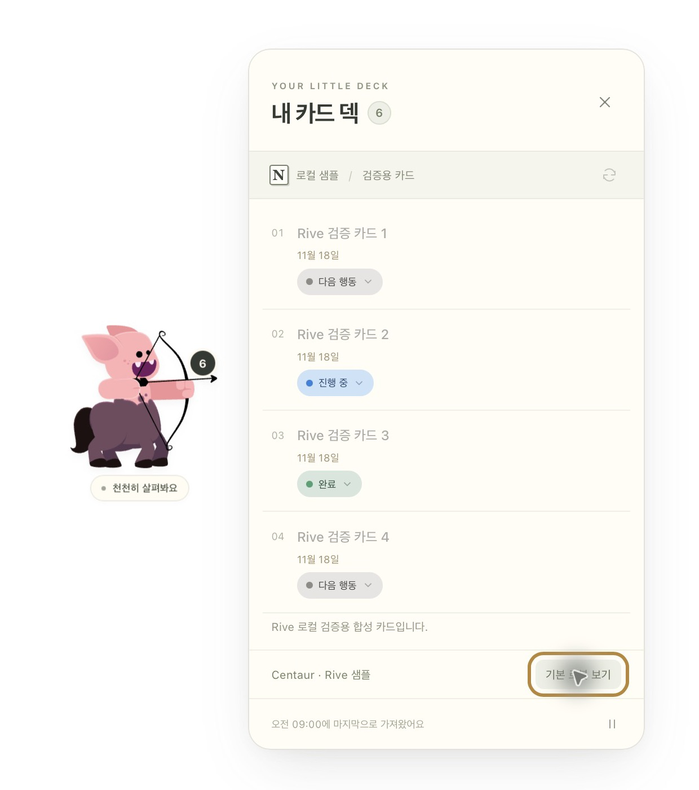

# Rive 캐릭터 동작 검증

기준일: 2026-11-18. Tauri·React·기존 이동 및 카드 UI를 유지하며 공식 무료 샘플 하나로 표현 경계를 검증한다. 실제 Notion 쓰기와 성능 비교는 이번 범위에 포함하지 않는다.

## 일반 모드에서 사용

일반 앱은 `pnpm desktop` 또는 인자 없는 릴리스 앱으로 실행한다. 카드 패널의 **캐릭터** 선택에서 Rive 샘플을 고르면 저장된 Notion 연결의 카드와 함께 표시한다. 기존 설정에 `characterBackend`가 없으면 기본 로봇으로 시작하며, 일반 모드에서 선택한 `robot`·`rive`는 다음 실행에도 복원한다.

캐릭터 선택은 전용 `set_character_backend` 명령으로 해당 필드만 저장한다. 키체인·Notion을 호출하지 않고 뷰·갱신 주기·산책 설정·카드 캐시를 보존한다. 저장에 실패하면 기존 캐릭터를 유지하고 오류를 알린다. 연결 설정을 저장할 때도 현재 캐릭터 선택을 유지한다. 검증 모드와 브라우저 미리보기에서는 선택을 메모리에만 반영한다.

아래 macOS 네 상태 기록은 합성 카드로 검증한 당시의 결과다. 실제 Notion을 사용하는 일반 모드의 실행 확인과 구분한다.

### 일반 모드 실행 확인 — 2026-11-18

- `pnpm desktop:build --bundles app`으로 기본 feature의 릴리스 앱을 빌드하고 인자 없이 실행했다.
- macOS 키체인 승인을 사용자가 처리한 뒤 저장된 연결에서 실제 Notion 카드 **5개**를 새로 조회했다.
- 카드 패널에서 Rive를 선택해 캐릭터·실제 카드·개수 배지를 함께 확인했다. 수동 새로고침도 성공했다.
- 앱을 종료·재실행해 `rive` 선택 복원과 실제 카드 재조회를 확인했다. 일반 모드에서 기본 로봇과 Rive의 왕복 전환도 확인했다.
- 프런트엔드 테스트 **57개**, 네이티브 테스트 **33개**, Clippy 및 릴리스 빌드를 통과했다. 기존 설정 이행, 선택값 제한, 캐시 보존, 저장 실패 시 기존 값 유지, 검증 모드 차단을 포함한다.

[일반 모드 실행·소스 해시 기록](validation/2026-11-18-rive-normal/metadata.json)에는 카드 개수와 갱신 시각만 포함한다. 실제 카드 제목·ID·뷰 ID·토큰과 화면 캡처는 저장소의 검증 자료에 포함하지 않는다. Windows 실기기 확인은 남아 있다.

## 구성

- 런타임: `@rive-app/webgl2-advanced` **2.51.0**, 공식 JS/WASM WebGL2 경로. 모델과 두 WASM 배포본은 앱에 포함하며 외부 CDN 로딩을 끈다.
- 모델: MIT로 배포된 공식 `centaur.riv`의 `Character` artboard만 선택한다. 별도의 `Background_tile` artboard는 그리지 않는다. 출처·고정 commit·해시·라이선스는 [자산 문서](rive-assets.md)에 기록했다.
- 화면 이동·드래그·입력 영역·React 카드는 기존 앱이 소유한다. Rive는 전용 canvas의 모델 재생만 소유한다.
- 하나의 host 시계가 34ms 간격으로 갱신한다. `Idle`·`Blink`의 기본 시간은 연속이고, `Aim`만 드래그 진입 시 한 번 재시작한다. 큰 delta는 100ms로 제한하며 숨김·동작 줄이기에서는 예약을 멈추고 복귀 시 경과 시간을 따라잡지 않는다.
- 행동 종료 시 타임라인에 없는 속성이 남는 샘플 특성을 처리하기 위해 artboard·track만 새로 만들고 기존 시간을 복원한다. 이 작업은 행동 전환 때만 수행하며 로딩한 파일·WASM·GPU surface는 유지한다.
- 표시 영역은 기존 168×160 CSS px, DPR 최대 2를 유지한다. 샘플의 빈 여백만 제외하는 모델별 fit 범위를 사용한다.
- 로딩 취소·실패·컨텍스트 손실에서 정리하고 정적 SVG로 대체한다. 컨텍스트 복구 시 새 canvas와 모델을 만든다. 카드 패널의 캐릭터 선택으로 기본 Pixi 로봇을 선택할 수도 있다.

## 상태 매핑

| 앱 상태 | 공간 이동 | 샘플의 실제 표현 |
| --- | --- | --- |
| 대기 `idle` | 정지 | `Idle` + `Blink` |
| 이동 `walk` | 기존 35 CSS px/s 이동 | 오른쪽 이동 `Walk`, 왼쪽 이동 `WalkBack`, 공통 `Blink` |
| 드래그 `dragging` | 기존 포인터 capture와 경계 제한 | 잡기 시작에 `Aim`을 한 번 재생하고 종료 자세 유지 |
| 카드 열람 `browsing` | 자율 이동 정지 | `Idle` + `Blink` 계속 재생 |
| 산책 끄기 `suspended` | 자율 이동 정지 | `Idle` + `Blink` 계속 재생 |
| 숨김·동작 줄이기 | 기존 정책대로 중지 | 예약 중단, 정지 자세 |

`WalkBack`은 모델의 뒤로 걷기이며 좌우 얼굴 반전은 아니다. `Aim`은 원본의 활 조준 동작을 드래그 반응으로 사용한 것이다. 잡힘·읽기 전용 모션이 있다고 주장하지 않는다. 카드 수 배지는 기존 DOM/SVG 레이어가 표시한다.

카드 패널이 화면 중앙의 캐릭터를 덮는 기존 배치 문제도 확인했다. 위·아래 공간이 모두 부족하면 좌우 여유 공간을 선택하도록 수정해 캐릭터를 계속 볼 수 있게 했다.

## 합성 카드 검증의 실행과 격리

기존 앱을 종료한 뒤 개발 검증은 `pnpm desktop:rive`로 실행한다. single-instance 식별자는 기존 앱과 같으므로 두 모드를 동시에 실행하지 않는다.

macOS 릴리스 검증:

```sh
pnpm desktop:build:rive --bundles app
'./src-tauri/target/release/bundle/macos/Card Captor.app/Contents/MacOS/card-captor' --character-validation
```

`character-validation` Cargo feature와 `--character-validation` 인자가 모두 있어야 검증 모드를 활성화한다. 측정 모드와 혼용하거나 중복·값을 넣은 옵션은 거부한다. feature가 있는 빌드도 인자 없이 실행하면 기본 모드다.

검증 모드에서는 계정 파일을 읽지 않고 키체인·Notion 요청·페이지 열기·상태 쓰기·연결 저장을 네이티브 명령 입구에서 차단한다. UI는 명시적인 합성 카드 6개를 사용한다. 산책 설정 변경은 메모리 안에서만 적용한다.

선택적으로 `CARD_CAPTOR_VALIDATION_LOG`에 출력 파일을 지정하면 상태·backend·가시성·프레임 누계·좌표만 JSONL로 기록한다. 카드 제목·URL·토큰·임의 문자열은 기록하지 않으며 이 명령은 검증 모드에서만 사용할 수 있다.

## 검증 결과

2026-11-18 13:33–13:35 KST, Apple M1 Max / macOS 27.2.1 arm64의 최종 릴리스 앱에서 확인했다. 아래 값은 상태별 관찰 근거이며 GPU present FPS나 전력 측정이 아니다.

| 확인 항목 | 실제 관찰 | 결과 |
| --- | --- | --- |
| 대기 | 좌표 변화 없이 렌더 호출 누계 `0 → 75` 증가. 드래그 후에도 `1201 → 1471` 증가 | 통과 |
| 이동 | `walk` 상태에서 관찰 구간 약 315 CSS px 이동, 누계 `90 → 332` 증가. 투명 배경의 캐릭터와 보행 모션 표시 | 통과 |
| 드래그 | 실제 포인터로 왼쪽 200 / 위 100 CSS px 이동, `dragging → idle` 복귀. 모델 유지·카드 오동작 없음 | 통과 |
| 카드 열람 | 6개 합성 카드의 패널을 열고 약 27초 동안 좌표 고정, 누계 `357 → 1081` 증가 | 통과 |
| 기본 로봇 복귀 | 버튼으로 `rive → webgl → rive` 전환. 재초기화 후 모션 재생과 카드 패널 유지 | 통과 |
| 표시·배치 | 배경 사각형·모델 잘림 없이 표시. 패널이 옆에 배치돼 캐릭터를 가리지 않음 | 통과 |

네 상태의 최종 세션에서는 `initializing`, `rive`, 수동 전환한 `webgl`만 기록됐다. `svg-fallback`·`context-lost`는 발생하지 않았다. [상태 기록](validation/2026-11-18-rive-macos/events.jsonl), [실행 환경·소스/실행 파일 해시·상태 요약](validation/2026-11-18-rive-macos/metadata.json)을 보관한다. 렌더 누계는 화면 표시 FPS가 아니라 성공한 draw 호출 수다.



자동 검증:

- 프런트엔드 테스트 **57개**, 네이티브 `measurement,character-validation` feature 포함 테스트 **29개** 통과.
- TypeScript·Vite 프로덕션 빌드, Rust Clippy 경고 검사, macOS 릴리스 앱 번들 생성 통과.
- 실제 WASM으로 최종 모델의 artboard·모션·반복·드래그 행동을 확인했다. 드래그·전진·후진 후 대기로 돌아올 때 같은 시간의 새 모델과 rig의 11개 변환을 비교해 잔여 자세를 검출·방지한다.
- 예약 작업 테스트에서 상태별 연속 갱신, 숨김/복귀 시간 분리, 실패/취소 후 예약 정리를 확인했다.
- 네이티브 테스트에서 실행 조건·합성 카드 격리·외부 동작 차단·진단 입력 제한을 확인했다.

남은 범위: Windows 실제 GUI, 강제로 유발한 GPU context loss/복구, OS 숨김·잠자기 복귀의 수동 확인. 고품질 방향 전환·동작 블렌딩과 자체 모델 제작은 후속 범위다. 이 기록의 실행 파일·소스 해시는 합성 카드 검증 당시의 것으로, 이후 추가한 일반 모드 캐릭터 선택의 검증 근거를 대신하지 않는다.
